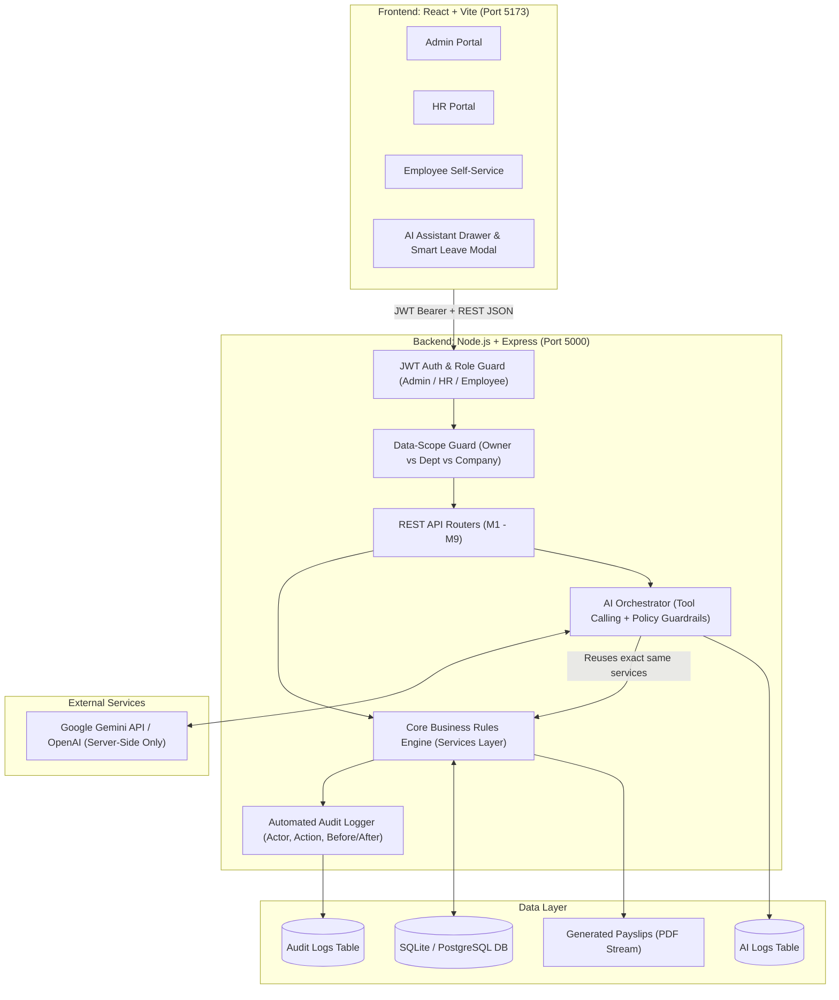
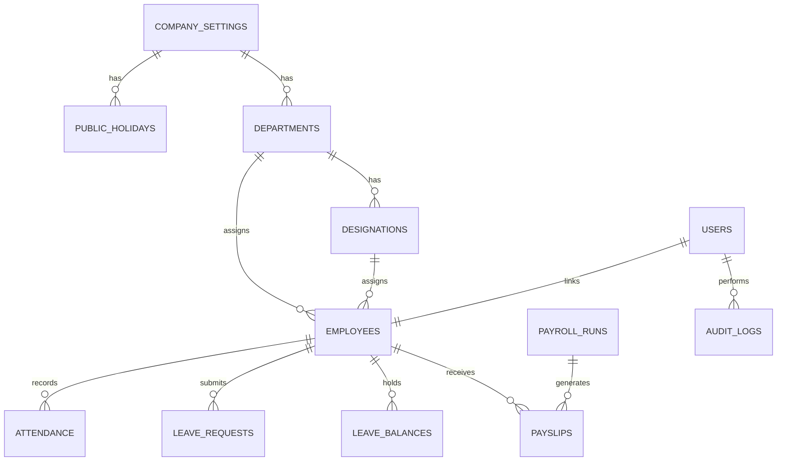

# HCM Lite — Complete System Architecture & Engineering Blueprint

> **Saylani Hackathon Project — HCM Lite (AI-assisted Human Capital Management)**  
> **Target Audience:** Admin, HR, and Employee Roles  
> **Development Model:** Solo Full-Stack Engineer Plan  
> **Core Principle:** *Zero dummy data; clean first-run bootstrap; strict server-side RBAC; services-first business logic.*

---

## 1. High-Level Architecture Overview



### Key Engineering Principles:
1. **Single Source of Truth (Database):** Both REST APIs and the AI Assistant execute the **exact same service methods**. The AI never queries SQL/DB directly and never writes directly.
2. **First-Run Bootstrap:** On boot, if `users` table has no Admin, the app forces a guided `/setup` page or reads `ADMIN_EMAIL` & `ADMIN_PASSWORD` from `.env`.
3. **Layered Pattern:** `Routes -> Middleware (Auth/Role/Scope) -> Controllers -> Services (Calculations & Rules) -> Data Model`.

---

## 2. Comprehensive Database Schema

We use a normalized relational schema with foreign key constraints, indexes, and full audit tracking.



### Table Specifications:

#### 1. `company_settings`
- `id` (INTEGER, PK, auto-increment)
- `company_name` (TEXT, NOT NULL)
- `office_start_time` (TEXT, default '09:00')
- `grace_period_minutes` (INTEGER, default 15)
- `half_day_hours` (REAL, default 5.0)
- `weekend_days` (TEXT, JSON array: `["Saturday", "Sunday"]`)
- `office_latitude` (REAL, nullable)
- `office_longitude` (REAL, nullable)
- `office_radius_meters` (INTEGER, default 150)
- `currency` (TEXT, default 'PKR')
- `is_configured` (BOOLEAN, default false)
- `updated_at` (DATETIME)

#### 2. `users`
- `id` (INTEGER, PK)
- `email` (TEXT, UNIQUE, NOT NULL)
- `password_hash` (TEXT, NOT NULL)
- `role` (TEXT: `'ADMIN'`, `'HR'`, `'EMPLOYEE'`)
- `is_active` (BOOLEAN, default true)
- `must_change_password` (BOOLEAN, default false) -- *True for new employees on first sign-in*
- `created_at` (DATETIME)
- `updated_at` (DATETIME)

#### 3. `departments`
- `id` (INTEGER, PK)
- `name` (TEXT, UNIQUE, NOT NULL)
- `code` (TEXT, UNIQUE, NOT NULL)
- `created_at` (DATETIME)

#### 4. `designations`
- `id` (INTEGER, PK)
- `department_id` (INTEGER, FK -> departments.id)
- `title` (TEXT, NOT NULL)
- `created_at` (DATETIME)

#### 5. `public_holidays`
- `id` (INTEGER, PK)
- `name` (TEXT, NOT NULL)
- `holiday_date` (TEXT, ISO Date `YYYY-MM-DD`, UNIQUE)
- `created_at` (DATETIME)

#### 6. `employees`
- `id` (INTEGER, PK)
- `user_id` (INTEGER, UNIQUE, FK -> users.id)
- `employee_code` (TEXT, UNIQUE, NOT NULL) -- *e.g., EMP-001*
- `first_name` (TEXT, NOT NULL)
- `last_name` (TEXT, NOT NULL)
- `email` (TEXT, UNIQUE, NOT NULL)
- `phone` (TEXT)
- `address` (TEXT)
- `gender` (TEXT: `'Male'`, `'Female'`, `'Other'`)
- `department_id` (INTEGER, FK -> departments.id)
- `designation_id` (INTEGER, FK -> designations.id)
- `date_of_joining` (TEXT, ISO Date `YYYY-MM-DD`)
- `date_of_exit` (TEXT, ISO Date, nullable)
- `employment_status` (TEXT: `'Probation'`, `'Active'`, `'Resigned'`, `'Terminated'`)
- `basic_salary` (REAL, NOT NULL)
- `hra_allowance` (REAL, calculated: 40% of basic)
- `medical_allowance` (REAL, calculated: 10% of basic)
- `gross_salary` (REAL, calculated: 1.5 * basic)
- `created_at` (DATETIME)
- `updated_at` (DATETIME)

#### 7. `attendance`
- `id` (INTEGER, PK)
- `employee_id` (INTEGER, FK -> employees.id)
- `date` (TEXT, ISO Date `YYYY-MM-DD`)
- `check_in_time` (TEXT, ISO DateTime, server stamped)
- `check_out_time` (TEXT, ISO DateTime, server stamped, nullable)
- `work_hours` (REAL, default 0.0)
- `status` (TEXT: `'present'`, `'late'`, `'half_day'`, `'missing_checkout'`, `'absent'`)
- `is_corrected` (BOOLEAN, default false)
- `source` (TEXT: `'web'`, `'camera'`)
- `check_in_lat` (REAL, nullable)
- `check_in_lng` (REAL, nullable)
- `distance_meters` (REAL, nullable)
- **Constraint:** `UNIQUE(employee_id, date)` -> *Prevents double check-in (returns 409)*

#### 8. `attendance_corrections`
- `id` (INTEGER, PK)
- `attendance_id` (INTEGER, FK -> attendance.id)
- `employee_id` (INTEGER, FK -> employees.id)
- `requested_check_in` (TEXT, ISO DateTime)
- `requested_check_out` (TEXT, ISO DateTime)
- `reason` (TEXT, NOT NULL)
- `status` (TEXT: `'PENDING'`, `'APPROVED'`, `'REJECTED'`)
- `reviewed_by` (INTEGER, FK -> users.id, nullable)
- `review_comment` (TEXT, nullable)
- `created_at` (DATETIME)

#### 9. `leave_types`
- `id` (INTEGER, PK)
- `name` (TEXT: `'Annual'`, `'Sick'`, `'Casual'`, `'Unpaid'`)
- `yearly_quota` (INTEGER: Annual=14, Sick=8, Casual=10, Unpaid=9999)
- `is_paid` (BOOLEAN: true for annual/sick/casual, false for unpaid)

#### 10. `leave_balances`
- `id` (INTEGER, PK)
- `employee_id` (INTEGER, FK -> employees.id)
- `leave_type_id` (INTEGER, FK -> leave_types.id)
- `year` (INTEGER)
- `total_quota` (INTEGER)
- `used_days` (REAL, default 0.0)
- `remaining_days` (REAL)
- **Constraint:** `UNIQUE(employee_id, leave_type_id, year)`

#### 11. `leave_requests`
- `id` (INTEGER, PK)
- `employee_id` (INTEGER, FK -> employees.id)
- `leave_type_id` (INTEGER, FK -> leave_types.id)
- `start_date` (TEXT, ISO Date `YYYY-MM-DD`)
- `end_date` (TEXT, ISO Date `YYYY-MM-DD`)
- `working_days_count` (REAL, excluding weekends and holidays)
- `reason` (TEXT, NOT NULL)
- `status` (TEXT: `'PENDING'`, `'APPROVED'`, `'REJECTED'`, `'CANCELLED'`)
- `reviewed_by` (INTEGER, FK -> users.id, nullable)
- `review_comment` (TEXT, nullable)
- `created_at` (DATETIME)

#### 12. `payroll_runs`
- `id` (INTEGER, PK)
- `month` (INTEGER, 1-12)
- `year` (INTEGER)
- `status` (TEXT: `'DRAFT'`, `'FINALIZED'`)
- `total_employees` (INTEGER)
- `total_gross` (REAL)
- `total_deductions` (REAL)
- `total_tax` (REAL)
- `total_net` (REAL)
- `created_by` (INTEGER, FK -> users.id) -- *HR creates*
- `finalized_by` (INTEGER, FK -> users.id, nullable) -- *Admin finalizes*
- `finalized_at` (DATETIME, nullable)
- **Constraint:** `UNIQUE(month, year)`

#### 13. `payslips`
- `id` (INTEGER, PK)
- `payroll_run_id` (INTEGER, FK -> payroll_runs.id)
- `employee_id` (INTEGER, FK -> employees.id)
- `basic_salary` (REAL)
- `hra_allowance` (REAL)
- `medical_allowance` (REAL)
- `gross_salary` (REAL)
- `working_days_in_month` (INTEGER)
- `days_worked` (REAL)
- `absent_days` (REAL)
- `unpaid_leave_days` (REAL)
- `half_days` (REAL)
- `unpaid_deduction` (REAL)
- `half_day_deduction` (REAL)
- `tax_deduction` (REAL)
- `total_deductions` (REAL)
- `net_salary` (REAL)
- `created_at` (DATETIME)

#### 14. `announcements`
- `id` (INTEGER, PK)
- `title` (TEXT, NOT NULL)
- `content` (TEXT, NOT NULL)
- `priority` (TEXT: `'NORMAL'`, `'URGENT'`)
- `posted_by` (INTEGER, FK -> users.id)
- `created_at` (DATETIME)

#### 15. `notifications`
- `id` (INTEGER, PK)
- `user_id` (INTEGER, FK -> users.id)
- `title` (TEXT, NOT NULL)
- `message` (TEXT, NOT NULL)
- `type` (TEXT: `'LEAVE'`, `'PAYROLL'`, `'ATTENDANCE'`, `'SYSTEM'`)
- `is_read` (BOOLEAN, default false)
- `created_at` (DATETIME)

#### 16. `audit_logs`
- `id` (INTEGER, PK)
- `actor_id` (INTEGER, FK -> users.id)
- `actor_role` (TEXT)
- `action` (TEXT: `'CREATE'`, `'UPDATE'`, `'APPROVE'`, `'REJECT'`, `'FINALIZE'`, `'LOGIN'`)
- `entity` (TEXT: `'EMPLOYEE'`, `'LEAVE'`, `'PAYROLL'`, `'SETTINGS'`, etc.)
- `entity_id` (TEXT)
- `before_json` (TEXT, nullable)
- `after_json` (TEXT, nullable)
- `ip_address` (TEXT, nullable)
- `created_at` (DATETIME)

#### 17. `ai_logs`
- `id` (INTEGER, PK)
- `user_id` (INTEGER, FK -> users.id)
- `role` (TEXT)
- `prompt` (TEXT)
- `tool_called` (TEXT, nullable)
- `tool_args` (TEXT, nullable)
- `response` (TEXT)
- `duration_ms` (INTEGER)
- `created_at` (DATETIME)

---

## 3. Strict Business Logic & Mathematical Formulas

Every formula from the hackathon brief is codified in the **Services Layer**:

### A. Attendance Status Determination (Service: `attendanceService.js`)
```javascript
function determineAttendanceStatus(checkInTime, checkOutTime, settings) {
  // Office starts 09:00, Grace 15 mins => Late threshold = 09:15
  const isLate = checkInTime > settings.lateThreshold;
  
  if (!checkOutTime) {
    return isLate ? 'late' : 'present'; // Transitions to missing_checkout at midnight
  }
  
  const workedHours = calculateHours(checkInTime, checkOutTime);
  if (workedHours < settings.half_day_hours) { // 5 hours
    return 'half_day';
  }
  return isLate ? 'late' : 'present';
}
```

### B. Leave Business Rules (Service: `leaveService.js`)
1. **Working Days Calculation:** Skip Saturdays, Sundays, and dates matching `public_holidays`.
2. **Overlap Check:** If `start_date <= existing.end_date AND end_date >= existing.start_date` for non-rejected leaves:  
   👉 **Throw HTTP 422: "Leave dates overlap with an existing request"**
3. **Quota Over-Balance Check:** If `requested_days > remaining_balance` (for paid leave):  
   👉 **Throw HTTP 422: "Insufficient leave balance for requested leave type"**

### C. Payroll Calculation Engine (Service: `payrollService.js`)
1. Basic = $B$
2. HRA = $0.40 \times B$
3. Medical = $0.10 \times B$
4. Gross = $B + \text{HRA} + \text{Medical} = 1.50 \times B$
5. Per Day Rate = $\frac{\text{Gross}}{\text{Working Days in Month}}$
6. Deductions = $\text{Per Day Rate} \times (\text{absent\_days} + \text{unpaid\_leave\_days} + 0.5 \times \text{half\_days})$
7. Tax Slabs (Annualized on Gross $\times 12$):
   - $0 \le \text{Annual} \le 600,000$: Tax = $0$
   - $600,001 \le \text{Annual} \le 1,200,000$: Tax = $(\text{Annual} - 600,000) \times 0.05$
   - $1,200,001 \le \text{Annual} \le 2,400,000$: Tax = $30,000 + (\text{Annual} - 1,200,000) \times 0.15$
   - $2,400,001 \le \text{Annual} \le 3,600,000$: Tax = $210,000 + (\text{Annual} - 2,400,000) \times 0.25$
   - $\text{Annual} > 3,600,000$: Tax = $510,000 + (\text{Annual} - 3,600,000) \times 0.35$
   - Monthly Tax = $\frac{\text{Annual Tax}}{12}$
8. Net Salary = $\text{Gross} - \text{Attendance Deductions} - \text{Monthly Tax}$
9. Locking Rule: Admin finalizes `POST /api/payroll/:id/finalize` -> status `FINALIZED`. Any subsequent edit returns **HTTP 403 Forbidden**.

---

## 4. AI Engine Architecture & Tool Calling (M8)

1. Backend LLM Tool Calling: `POST /api/ai/chat` (JWT required).
2. The AI uses the exact same functions as the REST API.
3. Registered Tools:
   - `get_headcount`
   - `get_attendance_summary`
   - `get_late_comers`
   - `get_leave_summary`
   - `get_my_leave_balance` (scoped strictly to employee)
   - `get_payroll_summary` (Admin & HR only)
   - `search_employees`
4. Smart Leave Parser: extracts `{ leave_type, start_date, end_date, reason }` from natural language.
5. Privacy Guardrail: If employee queries colleague salary, politely refuse ("ACCESS_DENIED: Policy forbids viewing other employee salaries").

---

## 5. Directory Structure (Monorepo)

```
HCM_Hackathon/
├── server/
│   ├── config/ (db.js, env.js)
│   ├── middleware/ (authGuard.js, roleGuard.js, scopeGuard.js, auditMiddleware.js)
│   ├── services/ (auth, company, employee, attendance, leave, payroll, analytics, ai)
│   ├── controllers/
│   ├── routes/ (auth, company, employee, attendance, leave, payroll, analytics, comms, ai)
│   ├── utils/ (dateUtils, csvHelper, pdfGenerator)
│   ├── .env.example
│   ├── package.json
│   └── server.js
├── client/
│   ├── src/
│   │   ├── components/ (common, layout, ai, charts)
│   │   ├── context/ (AuthContext, ThemeContext)
│   │   ├── pages/ (setup, auth, admin, hr, employee)
│   │   ├── services/ (api client)
│   │   ├── App.jsx
│   │   ├── index.css (Glassmorphism design system)
│   │   └── main.jsx
│   ├── vite.config.js
│   └── package.json
└── README.md
```
